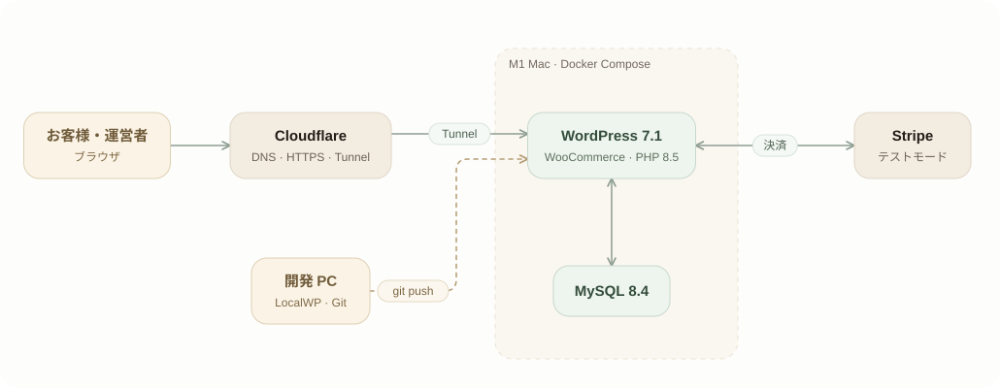

# Kapla Store

架空の香水・コスメブランド「Kapla」のオンラインショップを、**WordPress + WooCommerce のオリジナルブロックテーマ**で作り直したデモサイトです。2022 年の 3 人チームプロジェクト(Java / Spring / Oracle)のリメイクで、日本の小規模事業者のショップを想定し、日本語 UI、日本円(JPY)、税込表示で構成しています。決済は Stripe のテストモードのみで、実際の販売は行いません。

- 公開デモ: https://kapla.portfolio-hub.dev (自宅サーバーで運用しているため、停止している日があります)
- 紹介資料(お客様向け): [docs/portfolio/kapla-intro-ja.md](docs/portfolio/kapla-intro-ja.md)

## 構成

<picture>
  <source media="(prefers-color-scheme: dark)" srcset="docs/architecture-dark.svg">
  
</picture>

- お客様と運営者のアクセスは Cloudflare Tunnel 経由で自宅サーバーに届きます。ルーターのポートは開けていません。
- 開発は Windows の LocalWP で行い、テーマとプラグインを `git push` で自宅サーバーに反映します。
- 図の元データは [docs/architecture.json](docs/architecture.json) です。

### ディレクトリ

```
themes/kapla/              ブロックテーマ(theme.json、テンプレート、パターン、フォント、ヒーロー動画)
plugins/kapla-shop-tweaks/ 送料・支払い方法の表示・スパム対策などの小さな調整用プラグイン
infra/home-server/         自宅サーバー(Docker Compose + Cloudflare Tunnel)の配置ファイル(手順は docs/PROJECT.md)
scripts/                   WP-CLI ラッパー、初期データ投入(ページ・商品・配送・問い合わせフォーム・SEO)、素材の生成
seed/images/               商品画像(AI で生成した写真 12 点)
docs/                      プロジェクト記録、デザインシステム、構成図、紹介資料と画面キャプチャ(docs/portfolio/)
tools/capture/             画面キャプチャ用スクリプト(Chrome を操作して docs/portfolio/screenshots に保存)
```

## 技術スタック

| 区分 | 使用技術 |
|---|---|
| CMS・EC | WordPress 7.1.3 / WooCommerce 11.2.1 |
| テーマ | オリジナルのブロックテーマ(theme.json v3、ブロックテンプレート、PHP パターン、CSS) |
| 言語 | PHP 8.5、HTML、CSS |
| プラグイン | WooCommerce Stripe Payment Gateway(テストモード)、Contact Form 7、SEO SIMPLE PACK、自作の kapla-shop-tweaks |
| データベース | MySQL 8.4 |
| 決済 | Stripe(テストモード)、代金引換 |
| フォント | Zen Kaku Gothic New、Shippori Mincho、Cormorant Garamond(いずれも OFL、サーバーから配信) |
| 開発環境 | Windows 11、LocalWP、WP-CLI、PowerShell スクリプト |
| 公開環境 | MacBook Air M1、Docker Compose(`wordpress:7.1.3-php8.5-apache`、`mysql:8.4`、WP-CLI)、Cloudflare(DNS・Tunnel) |
| 補助ツール | Node.js + Puppeteer(画面キャプチャ)、Python + Pillow(商品画像の調整)、Git / GitHub |

## ローカルでの実行

前提: Windows で [Local](https://localwp.com/) に `kapla` サイトがあり(PHP 8.5、MySQL 8.4)、WooCommerce・Contact Form 7・SEO SIMPLE PACK・Stripe プラグインがインストールされていること。

1. テーマとプラグインを Local のサイトにつなぎます(ジャンクション)。

```powershell
$wp = "$env:USERPROFILE\Local Sites\kapla\app\public\wp-content"
New-Item -ItemType Junction -Path "$wp\themes\kapla" -Target "$PWD\themes\kapla"
New-Item -ItemType Junction -Path "$wp\plugins\kapla-shop-tweaks" -Target "$PWD\plugins\kapla-shop-tweaks"
```

2. 管理画面でテーマ `Kapla` とプラグイン `kapla-shop-tweaks` を有効にします。
3. ページ、商品、配送、問い合わせフォーム、SEO をまとめて作成します(何度実行しても安全です)。

```powershell
.\scripts\seed.ps1
```

4. テーマのパターンを変更したあとはキャッシュを消します: `.\scripts\clear-cache.ps1`
5. Stripe のテストキーを入力します: `.\scripts\stripe-test-keys.ps1`(`pk_test_` / `sk_test_` のみ受け付けます。キーはデータベースにだけ保存されます)

WP-CLI は `.\scripts\wp.ps1 <コマンド>` で実行します。商品画像の差し替え方法は `docs/ai-image-prompts.md` を参照してください。

## ドキュメント

- [プロジェクト記録(決済・配送、お問い合わせと SEO、自宅サーバーでの公開、納品用ホスティング調査)](docs/PROJECT.md)
- [デザインシステム(フォント・色・部品・動画と画像)](docs/design-system.md)
- [商品画像の作り方](docs/ai-image-prompts.md)

## 紹介用の資料

- [お客様向けの紹介文(日本語)](docs/portfolio/kapla-intro-ja.md)
- 画面キャプチャ(PC・スマートフォン 15 枚): `docs/portfolio/screenshots/`。撮り直すときは `cd tools/capture && npm install && npm run capture`(Chrome が必要。ローカルの `kapla.local` を撮影します)
