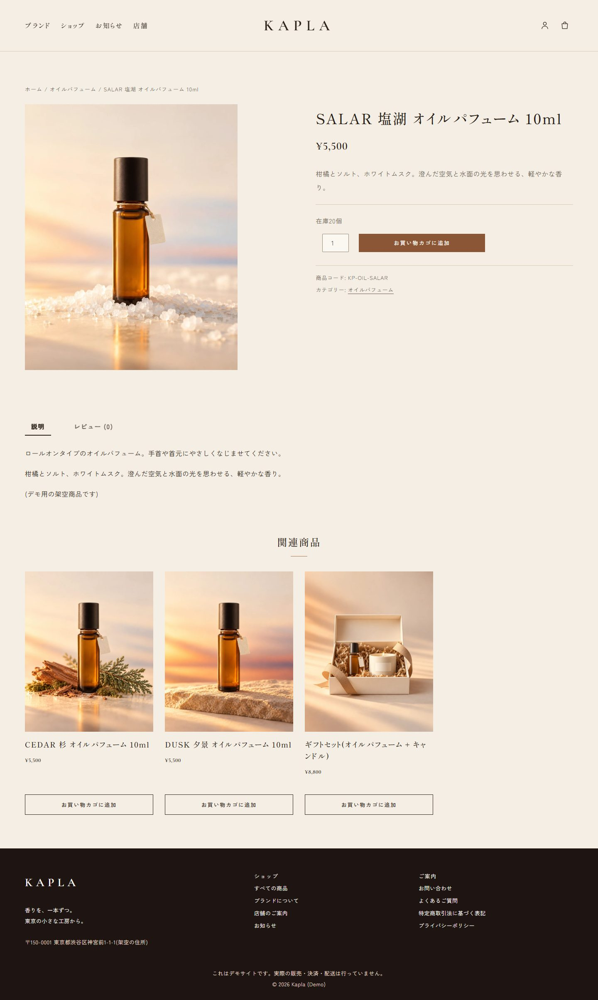
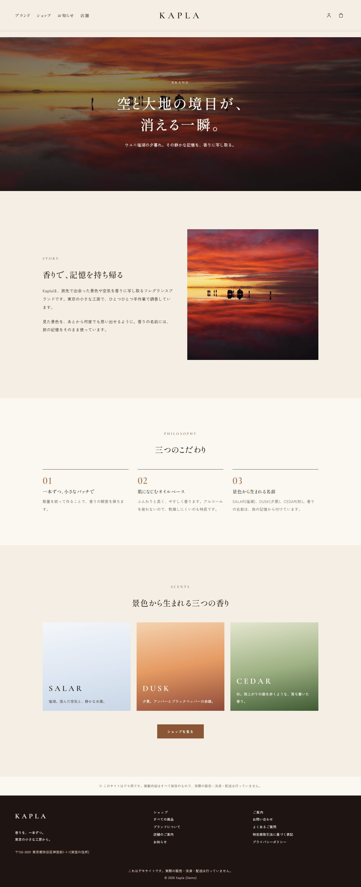
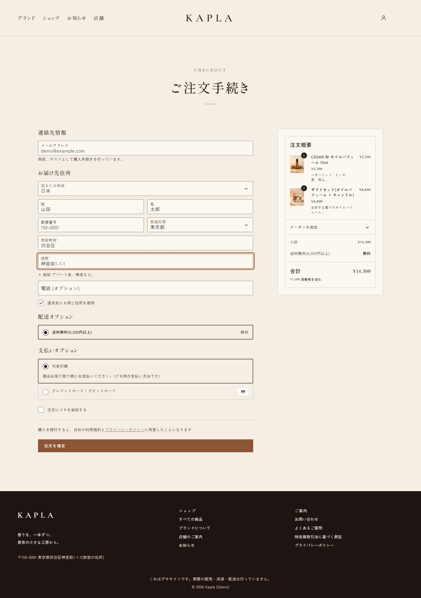
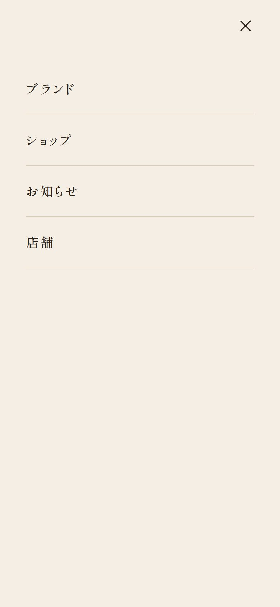
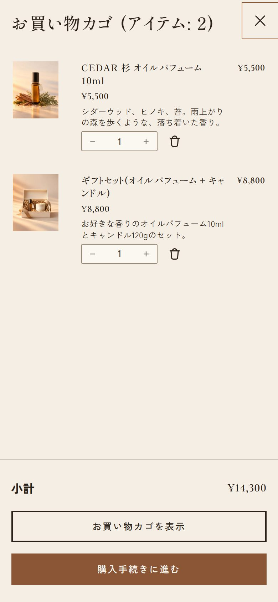

# Kapla ― 小さな香りブランドのためのオンラインショップ(制作実績)

> **これはデモサイトです。** 「Kapla」は架空のブランドで、実際の販売・決済・配送は行っていません。決済は Stripe のテストモードのみを使用しています。

## 概要

| 項目 | 内容 |
|---|---|
| 種類 | 香水・ホームフレグランスのオンラインショップ(架空のブランド「Kapla」) |
| 制作範囲 | 設計、デザイン、実装(WordPress テーマ)、日本向けの購入フロー設定、ページ制作 |
| 技術 | WordPress 7.1 / WooCommerce 11.2 / オリジナルのブロックテーマ / PHP 8.5 / Stripe(テストモード) |
| 対応 | PC・スマートフォン(レスポンシブ) |
| 言語・通貨 | 日本語 / 日本円(税込表示、消費税10%) |

## 制作の目的

日本の小さなお店でも、**ブランドの世界観が伝わり、そのまま売れる**ショップを、WordPress と WooCommerce で無理なく運用できる形でつくれることを示すために制作しました。

もともとは 2022 年にチームで制作した Java / Spring ベースの香水ショップでした。その題材を、小規模事業者に現実的な WordPress + WooCommerce で作り直し、デザイン・購入フロー・日本向けの仕様まで一から整えました。

## 画面イメージ

### PC

| ショップ一覧 | 商品詳細 |
|---|---|
|  |  |

| ブランドページ | ご注文手続き |
|---|---|
|  |  |

その他: [トップページ全体](screenshots/02-home-pc.jpg) / [カート](screenshots/06-cart-pc.jpg) / [店舗のご案内](screenshots/08-store-pc.jpg) / [よくあるご質問](screenshots/09-faq-pc.jpg)

### スマートフォン

| トップ | メニュー | お買い物カゴ |
|---|---|---|
|  |  |  |

その他: [ショップ一覧](screenshots/03-shop-sp.jpg) / [商品詳細](screenshots/04-product-sp.jpg) / [ご注文手続き](screenshots/06-checkout-sp.jpg)

## デザイン

**コンセプトは「Warm Editorial」**。クリーム色の背景にテラコタを差し色として使い、細い線と十分な余白で、雑誌のような落ち着いた雰囲気をつくりました。

- **書体**: 本文は Zen Kaku Gothic New、見出しとメニューは Shippori Mincho、ロゴと英字ラベルは Cormorant Garamond。いずれも商用利用できるライセンスのフォントで、サーバーから直接配信しています。
- **トップ**: 動画のヒーローから、おすすめ商品、ブランドストーリー、お知らせへと自然に読み進められる構成です。
- **ボタンと入力欄**: 高さと線の太さをそろえ、ショップ・カート・お問い合わせフォームで同じ見た目にしています。
- **アイコン**: 太さをそろえた細い線のアイコンに差し替えています。
- **文言**: 見出しの英字ラベル(SHOP、CART など)は雰囲気づくりに使い、メニューやボタンは日本語で分かりやすくしています。

## 主な機能

### お客様が使う機能

- 商品一覧(カテゴリ別、並べ替え)、商品詳細(画像、説明、レビュー、関連商品)、サイト内検索(商品のみ)
- お買い物カゴ(商品を追加すると右からカゴが開き、そのまま購入手続きへ進めます)
- ご注文手続き: 姓・名、郵便番号、都道府県、市区町村、住所など、**日本の住所の入力に合わせた項目**
- 送料: 全国一律 500 円、**8,000 円(税込)以上は送料無料**。無料条件を満たすと有料の送料は表示されません
- お支払い: クレジットカード / デビットカード(Stripe)、代金引換
- お知らせ、ブランドページ、店舗のご案内、よくあるご質問(開閉式)、お問い合わせフォーム
- 特定商取引法に基づく表記、プライバシーポリシー、返品・交換のご案内

### お店の運営者が使う機能

- 商品・価格・在庫・画像・カテゴリを、WordPress の管理画面から変更できます。
- ページの文章、画像、ボタン、おすすめ商品の並びなどを、ブロックエディタで直接編集できます。
- ページ見出しの英字ラベルとリード文は、各ページの入力欄から変更できます。
- 送料や支払い方法は WooCommerce の設定画面で調整できます。

## 技術と品質への配慮

- **オリジナルのブロックテーマ**: 既成テーマに頼らず、色・書体・余白の決まりを `theme.json` と CSS に整理しました。ページの多くを WordPress のブロックで構成しているため、あとから文章や並びを直しやすい作りです。
- **日本向けの設定**: 通貨は円(小数点なし)、税込表示、日本の住所入力、日本語の支払い方法名など、購入フローを日本の商習慣に合わせました。
- **迷惑メッセージ対策**: お問い合わせフォームには、見えない入力欄(ハニーポット)による簡易的なスパム対策を入れています。
- **再現できる構成**: ページ、商品、送料、フォーム、SEO 設定をスクリプトで再作成できるため、サーバーの移行や環境の複製が簡単です。
- **スマートフォン対応**: 主要なページを 375px 幅で確認し、横スクロールが出ないことを確認しています。
- **公開前の安全策**: デモ公開中は検索エンジンに載らない設定(noindex)と、全ページのフッターの「デモサイト」表示を入れています。

## ご注意

- 本サイトは**制作実績としてのデモ**です。商品、価格、住所、店舗は架空のものです。
- 商品写真は**AI で生成したデモ用の素材**です。実際の商品写真に置き換える手順(ファイル名を商品コードにして置くだけ)も整えています。
- 決済は **Stripe のテストモード**です。実際の請求は発生しません。

## お問い合わせ・ご相談

ショップの新規制作、既存サイトの見直し、WordPress / WooCommerce まわりのご相談をお受けします。まずはお気軽にご連絡ください。

- お名前: (ここに記入)
- メール: (ここに記入)
- ポートフォリオ: (ここに記入)
